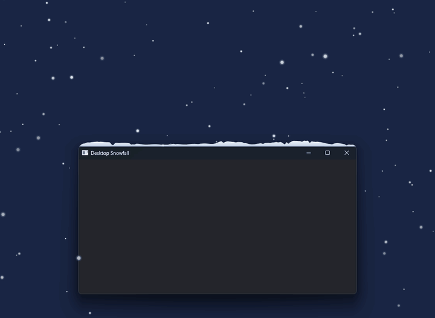

# Desktop Snowfall

A [Windhawk](https://windhawk.net) mod: snow falls over your desktop and settles on top of windows and the taskbar.

Toss a window up and the snow flies off in loose clumps, make it narrower and the cut-off snow falls down, sweep the snow off with the mouse cursor.

The mod is installed from Windhawk. This repository holds its media.
